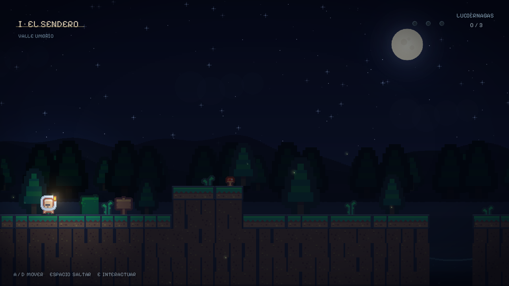
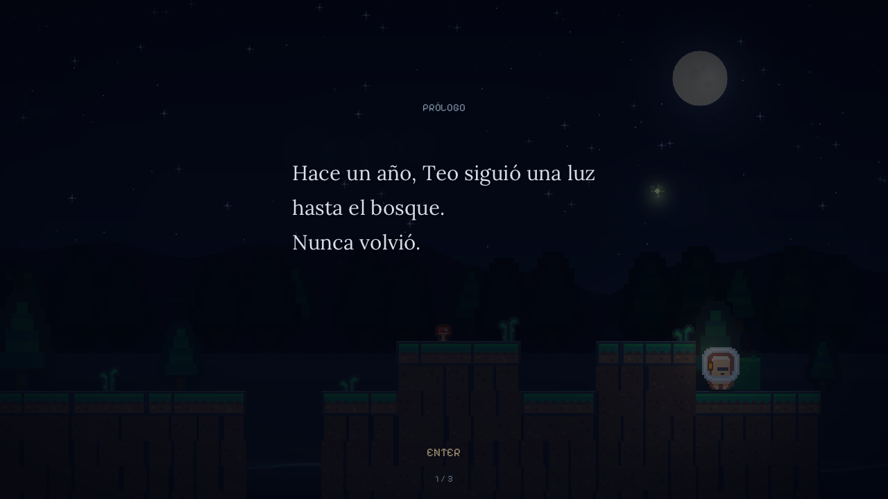
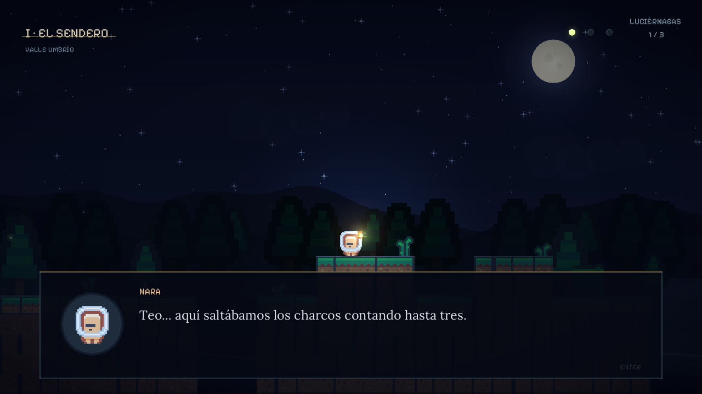
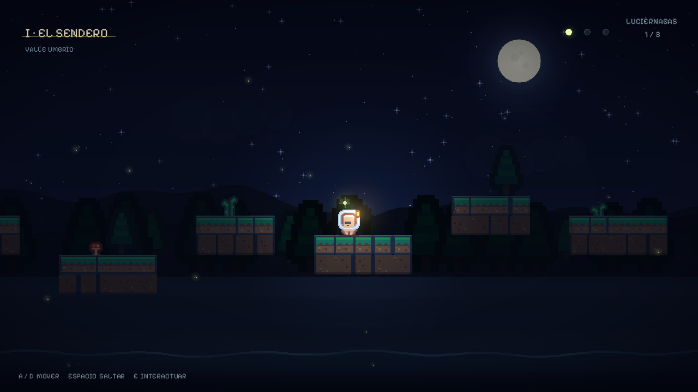
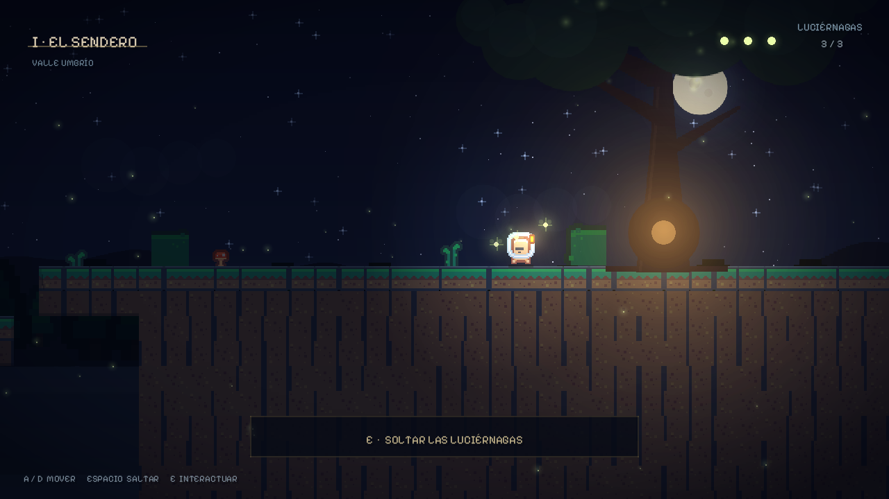
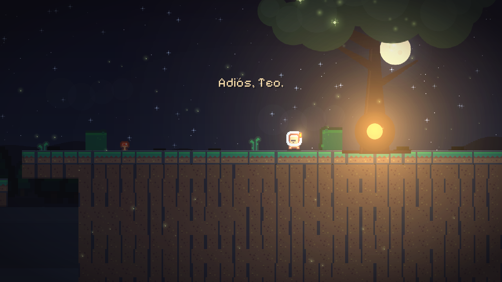
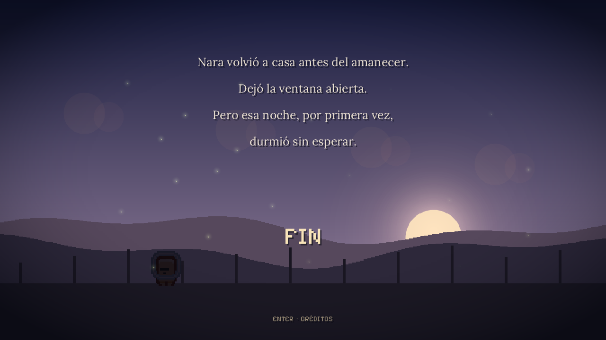

# La última luciérnaga

**La última luciérnaga** es un pequeño platformer narrativo en 2D, en español,
sobre dejar ir a quien queremos. Se juega en unos **5 minutos** y está hecho en
**C++17 + SDL2**, con gráficos pixel-art, texto narrativo en HD y música
sintetizada en tiempo real.

Está disponible para **Linux**, **Windows** y **Android**.



## Historia

Hace un año, Teo siguió una luz hasta el bosque y nunca volvió. Desde entonces
las luciérnagas dejaron de visitar Valle Umbrío. Esta noche, Nara deja la
ventana abierta y sale a buscar a su hermano por el sendero, el arroyo y la
colina, guiada por tres luciérnagas que aún recuerdan el camino.

Es un relato breve, sin voces: la historia se cuenta en diálogos mientras
avanzas. No hay combate ni enemigos; el reto está en saltar, leer el bosque y
llegar hasta el árbol de la colina.

## Capturas

| | |
|---|---|
|  |  |
|  |  |
|  |  |

## Características

- Aventura narrativa completa y autoconclusiva de unos 5 minutos.
- Tres luciérnagas que recoger, checkpoints, agua, diálogos y finales.
- Render HD a partir de un lienzo pixel-art de 640×360 (`RENDER_SCALE = 2`).
- **Resolución nativa**: se escala a la pantalla real, sin imagen pequeña
  centrada. En PC, pantalla completa sin bordes negros.
- Música y efectos generados por síntesis procedural: no hay archivos de audio.
- Controles táctiles en Android y compatibilidad con mando en todas las
  versiones.
- El mismo código y los mismos assets en las tres plataformas.

## Controles

### Teclado y mando

| Tecla | Acción |
|---|---|
| `A` / `D` o `←` / `→` | Moverse |
| `Espacio`, `W`, `↑` o `Z` | Saltar |
| `E` | Interactuar / avanzar diálogo |
| `Enter` o `Espacio` | Avanzar diálogo, confirmar |
| `Esc` o `P` | Pausa |
| `F11` | Pantalla completa |
| `F12` | Guardar captura |
| `R` (en pausa o créditos) | Reiniciar |
| `T` (en créditos) | Volver al título |
| `Esc` (en pausa) | Salir |

Con mando: `A` salta, `B` interactúa y `Start` pausa.

### Android (táctil)

| Gesto | Acción |
|---|---|
| Botones `‹` / `›` (abajo a la izquierda) | Moverse |
| Botón `⌃` (abajo a la derecha) | Saltar (mantén para saltar más alto) |
| Botón de luciérnaga (derecha) | Interactuar / soltar luciérnagas |
| Botón `❚❚` (arriba a la derecha) | Pausa |
| Tocar la pantalla | Avanzar diálogo, prólogo, epílogo y menús |

El botón **Atrás** de Android pausa la partida; en pausa la reanuda, y desde el
título cierra el juego. Si sales de la app, la partida se pausa sola.

## Cómo jugar

- Recoge las **3 luciérnagas** repartidas por el nivel. La luz que llevas
  también ilumina el camino.
- Los **checkpoints** son pequeños faroles: al tocarlos se activan y, si caes
  al agua, reapareces en el último.
- El agua no mata de inmediato: Nara se hunde y vuelve al checkpoint.
- Los diálogos se pueden acelerar manteniendo `E` o `Enter`; al terminar una
  conversación, el juego continúa solo.
- En la colina final hay que saltar entre plataformas estrechas. Si fallas,
  el checkpoint del arroyo te devuelve al tramo anterior.

## Descargar y jugar

| Plataforma | Ubicación | Requisitos |
|---|---|---|
| Linux | `la-ultima-luciernaga` (compilar con `make`) | SDL2 |
| Windows | `dist/windows/` | Windows 7+ 64 bits |
| Android | `dist/android/la-ultima-luciernaga.apk` | Android 5.0+ |

Cada carpeta de distribución incluye un `LEEME.txt` con instrucciones
específicas de instalación y controles.

### Linux

Requisitos: compilador C++17, `make`, `pkg-config` y SDL2.

En Debian/Ubuntu:

```bash
sudo apt install build-essential pkg-config libsdl2-dev
```

Desde la carpeta del proyecto:

```bash
make -j4
./la-ultima-luciernaga
```

También puedes usar `make run`, o arrancar directamente a pantalla completa:

```bash
./la-ultima-luciernaga --fullscreen
```

### Windows

La carpeta `dist/windows/` ya contiene el ejecutable y las DLL necesarias:

```
la-ultima-luciernaga.exe
SDL2.dll
libwinpthread-1.dll
assets/
captures/
LEEME.txt
```

Copia o descomprime la carpeta **completa** y abre `la-ultima-luciernaga.exe`.
No hace falta instalar SDL2.

Para recompilar desde Linux necesitas `mingw-w64` y el paquete de desarrollo
`SDL2-devel-2.32.10-mingw` (cabeceras y DLL de SDL2 para Windows):

```bash
SDL=~/ruta/a/SDL2-2.32.10/x86_64-w64-mingw32
x86_64-w64-mingw32-g++ -std=c++17 -O2 -Ithird_party -I"$SDL/include/SDL2" \
  -mwindows src/*.cpp -o dist/windows/la-ultima-luciernaga.exe \
  -L"$SDL/lib" -lmingw32 -lSDL2main -lSDL2 \
  -static-libgcc -static-libstdc++

cp "$SDL/bin/SDL2.dll" dist/windows/
cp /usr/x86_64-w64-mingw32/bin/libwinpthread-1.dll dist/windows/
```

La opción `--fullscreen` también funciona en Windows.

### Android

APK firmado listo para instalar en `dist/android/la-ultima-luciernaga.apk`.
Para probarlo en un dispositivo:

```bash
adb install -r dist/android/la-ultima-luciernaga.apk
```

También puedes copiar el APK al teléfono y abrirlo, permitiendo la instalación
de aplicaciones de origen desconocido.

La versión de Android comparte todo el código y los assets con la de PC. Añade
controles táctiles en pantalla, pantalla completa horizontal, pausa automática
al salir de la app y guarda las capturas (`F12`, si hay teclado) en el
almacenamiento privado de la aplicación.

#### Compilar el APK

El proyecto Android está en `android/` y usa **Gradle + ndk-build**. SDL2
2.32.10 ya está incluido en `android/app/jni/SDL`, así que no hay que instalarlo
aparte. Requisitos:

- JDK 17
- Android SDK con `platforms;android-35` y `build-tools;35.0.0`
- NDK `27.2.12479018`

Crea `android/local.properties` apuntando a tu SDK:

```properties
sdk.dir=/ruta/a/Android/Sdk
```

Y compila:

```bash
cd android
./gradlew assembleDebug
# APK: app/build/outputs/apk/debug/app-debug.apk
```

Para generar una versión de distribución firmada con la clave de depuración:

```bash
./gradlew assembleRelease
# APK: app/build/outputs/apk/release/app-release.apk
```

Los assets se copian automáticamente desde `assets/` al APK mediante la tarea
`syncGameAssets`; no hay que duplicarlos a mano. El icono se puede regenerar con
`python3 tools/make_icon.py`.

Para pruebas automatizadas se pueden pasar argumentos al juego desde `adb`:

```bash
adb shell am start -n com.ericson.luciernaga/.LuciernagaActivity \
  --es app_args "--autoplay"
# El resultado aparece en logcat con la etiqueta SDL/APP.
```

## Resolución y pantalla completa

El juego se compone en un espacio lógico de **640×360** y se rasteriza a
**1280×720** (`RENDER_SCALE = 2`) para conservar el detalle HD. Al presentar,
el lienzo se escala al tamaño real del renderer:

- **PC (Linux/Windows)**: en una pantalla 16:9 llena la ventana o la pantalla
  completa de forma uniforme y nítida. `F11` alterna pantalla completa
  (`SDL_WINDOW_FULLSCREEN_DESKTOP`, resolución nativa). La ventana se puede
  redimensionar y el contenido siempre ocupa todo el área, sin bordes negros.
- **Android**: la pantalla se llena por completo. En móviles más anchos que
  16:9 (19.5:9, 20:9…) la imagen se estira ligeramente en horizontal para no
  dejar barras; así se ve todo el escenario y la interfaz, sin recortes.
- El escalado es por vecino más cercano (`RENDER_SCALE_QUALITY = 0`) para
  mantener el aspecto pixel-art; el texto se rasteriza a 1280×720 para que los
  diálogos se vean nítidos.

## Modos de prueba

```bash
# Genera capturas de las escenas principales en captures/ (1280x720)
make capture

# Recorrido automático del nivel: comprueba que se pueden recoger las tres
# luciérnagas y llegar al final sin intervención humana
make autoplay

# Previsualiza en PC la interfaz táctil de Android
./la-ultima-luciernaga --touch
```

El autoplay termina imprimiendo `AUTOPLAY: OK` si completa la historia, o
`AUTOPLAY: BLOQUEADO` si se queda atascado.

### Depuración

```bash
make debug
```

Compila con `-g -O0` y AddressSanitizer/UBSan. `make clean` borra objetos y
binario.

## Estructura del proyecto

```
src/main.cpp      estados de juego, historia, jugador, cámara y render
src/gfx.cpp       ventana, sprites, texto TTF, luces y capturas
src/gfx.hpp       API gráfica y constantes de resolución
src/level.cpp     geometría del nivel, agua, árbol y entidades
src/audio.cpp     música ambiental y efectos por síntesis procedural
assets/           sprites, fuentes y licencias
third_party/      stb_image, stb_image_write y stb_truetype
captures/         capturas generadas por make capture
android/          proyecto Android (Gradle + ndk-build, SDL2 incluido)
dist/windows/     versión jugable para Windows con sus DLL y LEEME
dist/android/     APK firmado listo para instalar y LEEME
tools/            generador del icono de Android
Makefile          compilación, capturas y autoplay en Linux
```

## Notas técnicas

- **Lora** se usa para el texto narrativo (prólogo, diálogos y epílogo) y
  **Pixelify Sans** para títulos, HUD y etiquetas de interfaz.
- La música y los efectos se sintetizan al arrancar; no hay archivos de audio.
- Las capturas de `--capture` y `make capture` se guardan a 1280×720. Las de
  `F12` se guardan a la resolución real del renderer (por ejemplo, 1920×1080 en
  pantalla completa). En Android van al almacenamiento interno privado de la
  app (`/data/data/com.ericson.luciernaga/files/`).
- Los assets se cargan con `SDL_RWops`, de modo que funcionan tanto desde
  archivos sueltos en PC/Windows como desde dentro del APK en Android.
- La entrada táctil usa `SDL_FINGER*` normalizado a la ventana; el lienzo ocupa
  la ventana completa, así que la conversión a coordenadas de juego es directa.
- El botón Atrás y la pausa al pasar a segundo plano se gestionan con eventos
  de ciclo de vida de SDL.

## Recursos y licencias

- **Kenney — Pixel Platformer** (sprites de terreno, personajes y decoración):
  CC0. Ver `assets/licenses/Kenney-CC0.txt` y <https://kenney.nl>.
- **Pixelify Sans**: SIL Open Font License 1.1.
  Ver `assets/licenses/PixelifySans-OFL.txt`.
- **Lora**: SIL Open Font License 1.1.
  Ver `assets/OFL-Lora.txt` y <https://fonts.google.com/specimen/Lora>.
- **stb_image / stb_image_write / stb_truetype**: dominio público
  (Sean Barrett y colaboradores). Ver las cabeceras en `third_party/`.
- **SDL2**: zlib License. Ver <https://www.libsdl.org/license.php>.

La historia, el código y la música procedural son originales de este proyecto.
